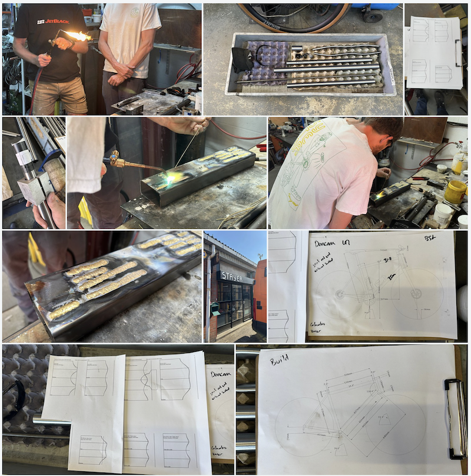
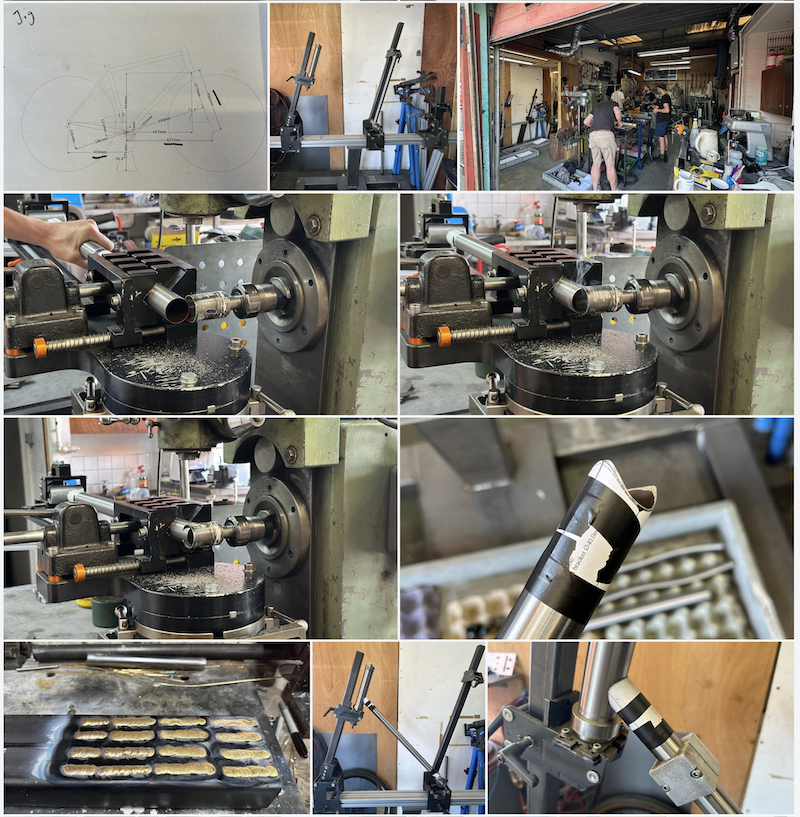
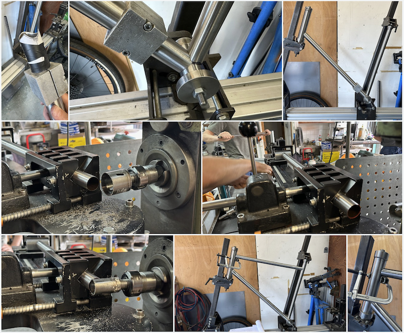
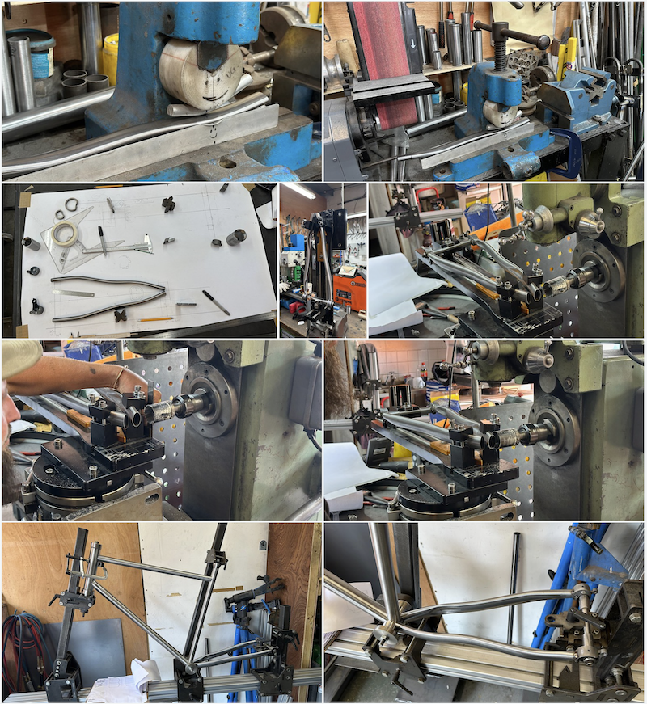
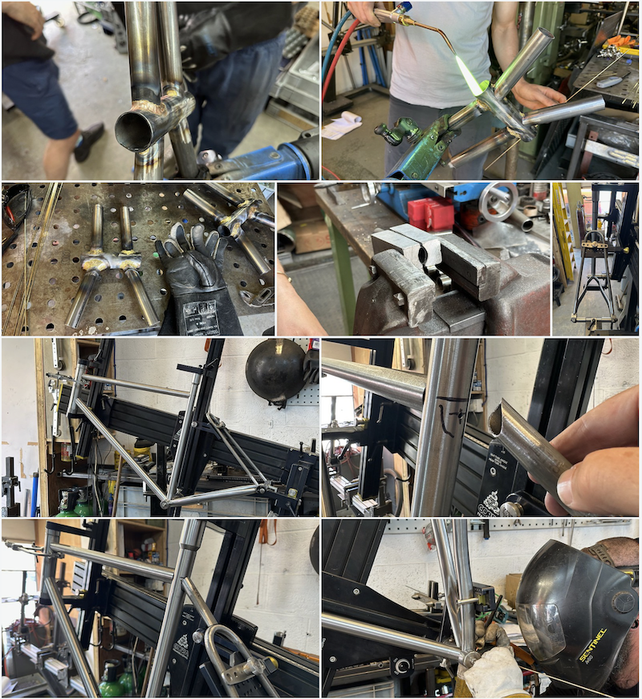
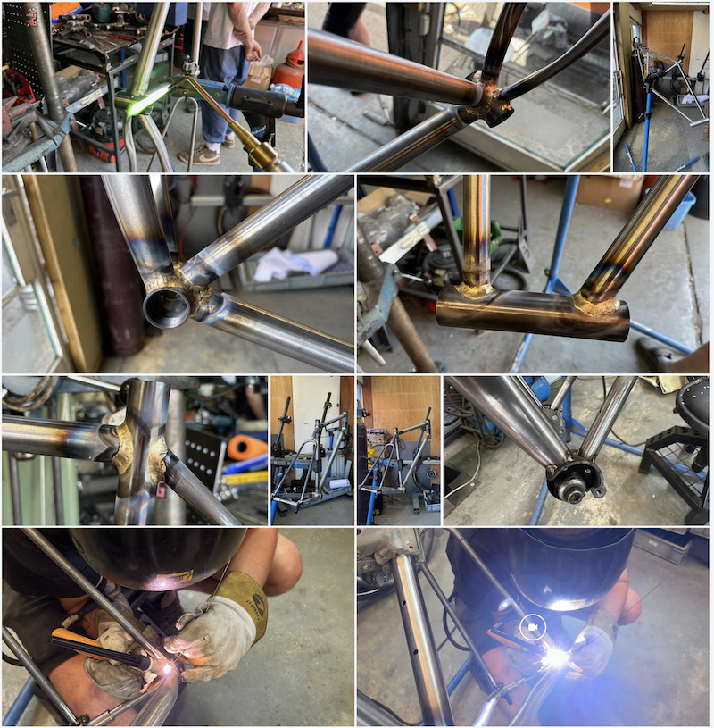
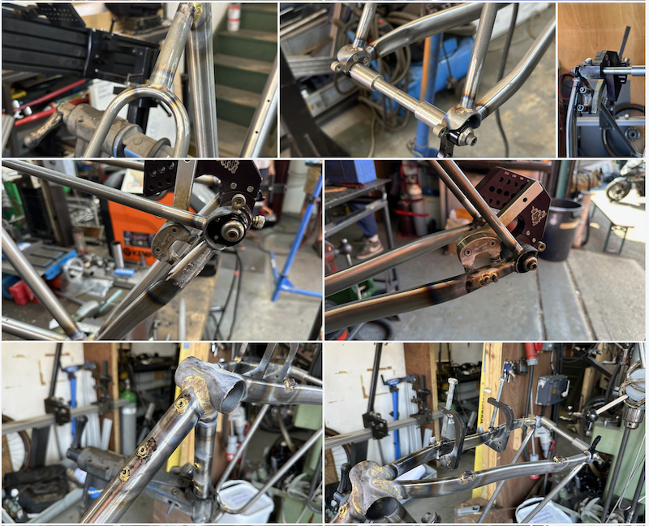
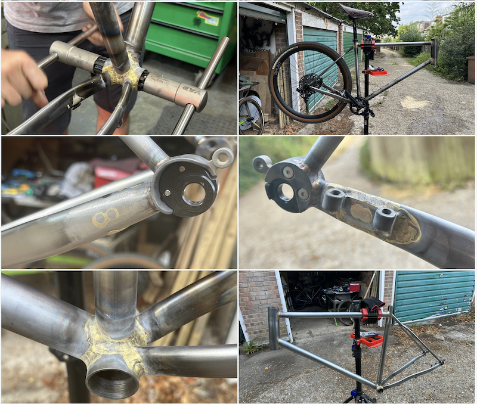

Frame building 101 with Stayer Cycles. My first time frame building and it's been a steep learning curve. A few notes on the [blog](https://www.iot.io/blog/2026/07/19/Stayer.html) and favourite photos below from [Flickr Album](https://www.flickr.com/photos/pseudonomad/albums/72177720334746152/with/55404631746).

<!--more-->

